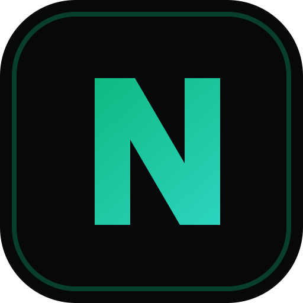

# 🎬 SocialCraft Studio

<p align="center">
  
</p>

<p align="center">
  <strong>Plataforma Autônoma de Criação de Vídeos, Prints 4K com Mockup 3D & Agendamento Social para Projetos Locais e GitHub</strong>
</p>

<p align="center">
  <a href="https://socialcraft-eight.vercel.app"></a>
  <a href="https://github.com/Henrique1601/socialcraft"></a>
  <a href="./LICENSE"></a>
  
  
</p>

---

## 🚀 Sobre o SocialCraft

O **SocialCraft** é um estúdio web e mobile (PWA) projetado para desenvolvedores e criadores transformarem código e projetos em mídia de alto impacto para redes sociais (Instagram Reels, TikTok, YouTube Shorts, LinkedIn e X/Twitter).

Em vez de criar publicações manualmente no chat, o **SocialCraft** conecta os agentes do ecossistema de IA diretamente ao seu navegador e smartphone, permitindo:

1. **Central de Criação dos Agentes de IA:**
   - Indexação de **87 projetos locais do PC** e **94 repositórios do GitHub** (181 projetos catalogados).
   - Geração autônoma de **Vídeos Motion (9:16 vertical ou 16:9)**, **Prints 4K Retina com Mockups 3D** ou **Carrosséis Bento**.
   - **Catálogo de 10 Estilos de Vídeo Parametrizados:** Terminal Cyber, POV Hands-on, Bento Grid, Apple Cinematic, Glitch Hack, etc.
   - **Terminal HUD em Tempo Real:** Visualização do pipeline dos agentes compilando assets passo a passo.

2. **Upload & Drag and Drop Studio:**
   - Arraste vídeos ou capturas de tela do computador.
   - No celular, grave ou envie diretamente da câmera/galeria via PWA.
   - Molduras 3D fotorrealistas (iPhone 16 Pro Max, MacBook Pro, Studio Display).

3. **Esteira de Agendamento Inteligente:**
   - Visualização em calendário e esteira estilo Buffer.
   - Aprovação de rascunhos gerados pelos agentes com 1 clique.
   - Copywriting técnico anti-slop e geração de hashtags de alcance orgânico.

---

## 🛠️ Stack Tecnológica

- **Framework:** Next.js 16 (App Router + Turbopack)
- **UI & Estilização:** React 19, Tailwind CSS v4, Lucide React, Canvas Confetti
- **Mobile:** Progressive Web App (PWA) nativo com manifest e Bottom Navigation
- **Automação de Mídia:** GSAP, Remotion-ready, Playwright & Chrome DevTools MCP
- **Deploy:** Vercel Edge Network

---

## 💻 Como Rodar Localmente

```bash
# Clone o repositório
git clone https://github.com/Henrique1601/socialcraft.git

# Acesse a pasta
cd socialcraft

# Instale as dependências
npm install

# Inicie o servidor local
npm run dev
```

Abra [http://localhost:3000](http://localhost:3000) no seu navegador.

---

## 📱 Instalação no Celular (PWA)

1. Abra [https://socialcraft-eight.vercel.app](https://socialcraft-eight.vercel.app) no Safari (iOS) ou Chrome (Android).
2. Toque no botão de compartilhamento / opções do navegador.
3. Selecione **"Adicionar à Tela de Início"** (Add to Home Screen).
4. O SocialCraft abrirá como um aplicativo nativo independente, sem barra de navegação do browser.

---

## 📄 Licença

Distribuído sob a licença **MIT**. Veja [`LICENSE`](./LICENSE) para mais informações.
